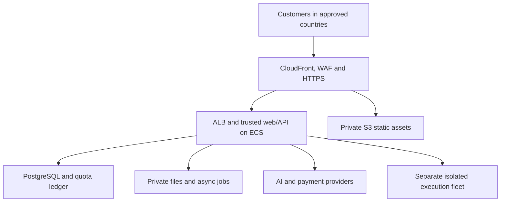

# FutureRobotic AI — worldwide AWS release plan

Historical PLAN-01 baseline. Current implementation/status: `BUILD02_REPORT.md` and `FEATURE_STATUS.json`. The missing-feature descriptions below preserve the original audit; they are not the Build 02 code inventory.

Baseline: **PLAN-01**. Reviewed **22 October 2026, India time**. Reference capture: **21 October 2026**. Current source: `43da07ff19426ce10f31420d8833b7ce0799686f`.

The goal is a production SaaS product with the public website, all eight tools, the signed-in workspace and right-side AI assistant, durable user data, subscriptions and a worldwide AWS deployment. The existing site is a useful private UI/local-tool preview. It is not a production backend, database or AWS release.

This first delivery establishes scope, architecture, acceptance criteria, evidence and the implementation sequence. It does not claim to have built the missing production services. `FEATURE_STATUS.json` is the machine-readable baseline; `FEATURE_STATUS.xlsx` is the working tracker. Keep task IDs stable in subsequent builds.

## 1. Blocked operations first

| ID | Operation currently blocked | Observed reason | Code work that can continue |
|---|---|---|---|
| B01 | Build/run Docker images, database containers and sandbox integration tests | Docker executable is absent here | Dockerfiles, compose, migrations, service code and test fixtures |
| B02 | Provision or validate AWS production resources | AWS CLI, a supplied deployment role and AWS account access are unavailable | IaC, application code, CI definitions and runbooks |
| B03 | Verify real AI conversion, generation, explanation, checking, fixing and chat | Existing hosted runtime has no provider secret or model quota configured | Gateway, streaming, model policies, mock tests and evaluations |
| B04 | Verify payment-provider integration and live subscriptions/refunds | No approved merchant account, sandbox/live configuration or live-test authorization | Billing/ledger adapters, checkout UI and event-replay tests |
| B05 | Activate branded DNS, TLS and sender records | Owner domain and DNS control not supplied | Parameterized domain/CDN/email templates |
| B06 | Verify real Google/GitHub user login | Production OAuth applications not supplied | Auth routes, sessions, safe identity linking and mock tests |
| B07 | Deliver email OTP and support messages to customers | Verified sender/support mailbox and SES production access not supplied | Email queue, OTP logic, templates and ticket APIs |
| B08 | Publish final business, market, privacy and pricing commitments | Owner decisions and approvals outstanding | Configurable catalog, draft policies and product implementation |
| B09 | Run an owner-controlled protected deployment pipeline | Repository/CI deployment trust has not been selected/configured | Workflow source, build/test/scan/deploy scripts |

**Dependency installation is not currently an observed blocker.** The existing dependencies are installed. TypeScript and the current utility/API mock tests passed on this audit. A clean install of the future portable AWS project still needs its own evidence. If a future install actually fails, record the command, error, affected tasks and unblock action; do not mark unrelated code work blocked.

Blocked means a specific operation cannot be completed with the available runtime/accounts. An implementation task can remain Not started or Partial while its final live verification depends on a blocker. Generated configuration or passing mock tests do not close live AWS/payment/provider gates.

## 2. Source coverage and its limits

The supplied ZIP contains 57 JPEG screenshots, an inventory, screenshot index/manifest, a PDF and 532 discovered links. The link list contains 68 source-language directory links and 68 language-pair converter links, plus other URLs. These link counts are not independently captured screens or proof of every possible language combination.

All 57 screenshots are mapped to task IDs in `REFERENCE_CROSSWALK.csv`. The separately supplied signed-in video is evidence for the dark workspace, tool navigation, model controls, notes, account/billing navigation and right-side chatbot appearance/interactions. It is labeled **V1** in the tracker.

The archive explicitly says authenticated settings, cloud files/history, billing and AI chat were not entered during that capture. Those advertised capabilities remain in target scope, with their evidence labeled advertised. Mobile layouts were not captured. This plan covers the supplied material; it does not claim access to the reference company's internal backend, source or complete private feature set.

Reference results demonstrate the reference service. They do not prove FutureRobotic AI produces the same result. New model evaluations must use our implementation and record actual provider/run evidence.

## 3. Current application audit

| Area | Current evidence | Production gap |
|---|---|---|
| Public UI | Beige homepage, four tool cards, logo strip, 68 language cards, eight tool routes and footer | Missing detailed discovery routes, full plan comparison, French UI and complete production content |
| Workspace | Dark UI, searchable language choices, tool navigation, panel controls, local notes/files/history | No durable account/workspace backend or cloud synchronization |
| AI tools | Server-side adapter and bounded input/context validation; provider transport mocked in tests | No live key/model validation, streaming, model tiers or durable run/usage records |
| Chatbot | Right panel, quick prompts, local guidance, context payload and explicit apply-code control | No real provider verification, persistent sessions, safe rich Markdown or full stream lifecycle |
| Converter | Four exact example pairs and reverse directions | Arbitrary conversions require real AI and quality evaluations |
| Comment remover | Tested local processing for several language families | Offered language coverage and parser edge cases need an explicit verified matrix |
| Runner | Plain JavaScript in a disposable browser worker, five-second timeout | Python/C/C++/Java, remote status/timing and robust untrusted execution service absent |
| PDF | Basic valid multipage ASCII PDF | Font sizes, theme, margins, title controls, 50k input, Unicode and print parity absent |
| Files/history | Browser-local 20 files/500 KB and 30 results | S3, ZIP extraction, per-plan capacity, private cloud data and retention jobs absent |
| Billing | Proposed Free/Pro/Premium prices and preview billing screen | Checkout, payment webhooks, subscriptions, invoices, refunds and entitlements absent |
| Identity | Current owner-private Site is protected by Sites authentication | AWS public accounts need independent Google/GitHub/email-OTP sessions |
| Database | No product database or migrations; hosting storage bindings are null | Entire relational data model and durable job/ledger implementation |
| Hosting | Existing owner-private Sites deployment, version 2 | No AWS infrastructure, production domain, pipeline, monitoring or recovery evidence |

Current preview: https://futurerobotic-ai.pearly-zebra-9453.chatgpt.site . Its existing access policy was not changed by this planning work.

## 4. Complete target product scope

### Public website

Match the supplied desktop composition under the FutureRobotic AI brand: hero, navigation/menu, language ribbon, four tool cards, workspace illustration, benefits, closing call to action and footer. Use owned/recreated product artwork before commercial release and verify retained logo/font licenses.

Implement the eight free-tool pages, complete tool-specific steps/FAQs/examples, full pricing comparison, support contact, dedicated Code Privacy, Privacy Policy and Terms pages. Add source-language directories and language-pair converters from a validated language/slug registry. English and French are target website locales; communication/reporting to the owner stays in English.

Use one authoritative language catalog. The existing selector has 72 choices, while the reference homepage advertises 62 and its directory contains 68 entries. Normalize aliases and display counts truthfully. AI translation language support is distinct from runner language support. Do not imply that all selectable languages can execute in the runner.

### Eight tools

| Tool | Complete frontend behavior | Backend/quality requirement |
|---|---|---|
| Converter | Source/target languages, upload, instructions, editors, code/output tabs, expand/copy/download/share | Real conversion, bounded context, measured usage and behavioral fixture checks |
| Generator | Natural-language prompt, output language, instructions, generated code/actions | Generation schema, correct language and runnable fixtures |
| Explainer | Code input, rendered explanation, examples, expanded reader, Markdown exports | Safe structured Markdown and evaluated behavior/edge-case explanations |
| Checker | Issues, severity/evidence, original/fixed snippets, full corrected code | Structured review and known-bug/false-positive evaluation |
| Fixer | Error context, original code, inline diff, fixed-code/output tabs, change summary | Complete fix plus separate summary; deterministic diff; optional user-run verification |
| Comment remover | Supported language matrix, source/cleaned output, expanded editors/actions | Parser-backed or clearly bounded local processing; no false all-language claim |
| Code to PDF | 50k input, five font sizes, light/dark, five margins, line numbers, optional custom title, print/export | Correct Unicode, pagination, escaping and rendered document verification; no AI required |
| Code runner | Searchable Python/JavaScript/C/C++/Java, source, stdout/stderr, exit status, duration, run again | Isolated compile/run service, strict resource/egress limits, queue fairness and daily quota |

Every editor needs keyboard access, clear/load behavior, safe file input, accurate counters, language-appropriate exports, busy/stream/error/cancel states and no loss of source on failure. Copy/share/download actions differ between Markdown and code outputs.

### Signed-in workspace and right-side chatbot

Provide personal workspace home, pinned tools/pairs, curated popular tools, tool navigation, reference-file selection, files, history, per-result notes, model/tier choices, billing/account pages and collapsible sidebar/main/chat panels.

The right-hand assistant uses the same AI gateway as the tools. It receives only authorized selected source/result/file revisions. It supports follow-up sessions, quick prompts, streaming, stop/retry, safe Markdown/fenced code, attachments and explicit apply-to-result with version recovery. Main-tool and assistant visibility controls must never strand the user without a way to restore the layout.

Do not claim code was executed, tested or applied unless a real runner outcome or explicit user apply action supports that claim. Local help stays clearly labeled while live AI is unavailable.

### Cloud data, accounts and subscriptions

Add Google, GitHub and email OTP signup/login/logout, portable sessions, account preferences/export/deletion and a minimal audited operator role. Add private cloud files, safe ZIP import, supported parser types, dependency-folder exclusions, history/chat persistence, local-only mode, selective sharing and retention/deletion jobs.

Add real checkout, signed webhooks, monthly/annual subscriptions, entitlements, allowances, invoices/portal, cancellation, plan changes, failure recovery, refunds and reconciliation. Keep the reference plan capabilities in scope, but do not advertise paid capacity or refund guarantees before implementation and owner approval.

## 5. Architecture decision

Use a TypeScript monorepo with a portable React/Next.js web app, a modular Node API and shared schemas/policies. Keep one deployable API initially; split operationally distinct workloads such as execution and async extraction without creating a service for every tool.

The existing Vinext/Cloudflare/Sites code is the visual and local-function baseline. It cannot simply be uploaded to AWS and retain trusted Sites authentication and Worker bindings. Reuse components and logic, replace hosting adapters and identity, then run portable integration tests. Keep the working preview available during the migration.

| Layer | Proposed choice | Reason and boundary |
|---|---|---|
| Web | React + standard Next.js, TypeScript | Reuse components, server-render public discovery pages, containerize for AWS |
| API | TypeScript Node service, Fastify, Zod/OpenAPI | Clear validation, ownership, SSE and testable service boundaries |
| Persistence | PostgreSQL on Amazon RDS, Drizzle migrations | Transactional identities, subscriptions, reservations and append-only ledger |
| Cache/limits | ElastiCache Valkey where needed | Shared rate/concurrency coordination; durable allowance truth stays in PostgreSQL |
| Objects | Private S3 buckets with KMS | Source files, quarantine, revisions and expiring exports |
| Async work | SQS + DLQs + transactional outbox + scheduler | Bounded extraction, cleanup, reconciliation and retries |
| Trusted web/API compute | ECS Fargate behind ALB | Reproducible deployment, separate task roles, health/draining/autoscaling |
| Public edge | Route53, ACM, CloudFront, WAF | Global static delivery, HTTPS, edge abuse controls and origin restrictions |
| Execution | Separate EC2/gVisor worker fleet/account/VPC | Untrusted user code never runs inside the trusted web/API service |
| Identity | Maintained authentication library plus DB sessions and SES OTP service | Portable Google/GitHub OAuth and explicit one-time-code behavior |
| AI | Server-only provider adapter and capability/model registry | Routing, tiers, context budgets, streaming, usage and clear data handling |
| Billing | One merchant-of-record/provider adapter, Paddle candidate after approval | Avoid implementing multiple payment providers before one verified integration |
| Operations | Secrets Manager, IAM roles, CloudWatch/OpenTelemetry and IaC | Short-lived access, private secrets, observability and repeatable recovery |

This is a proposed design, not deployed infrastructure. AWS service/version/instance availability must be checked in the selected account/region before applying IaC. Default primary-region assumption: Mumbai (`ap-south-1`), subject to service availability, actual users, latency and provider/data requirements. It is editable configuration, not a deployment already performed.

AWS documents ECS/ALB multi-AZ guidance and CloudFront global content delivery [S1]. RDS Multi-AZ instance deployment provides synchronous standby/failover; that standby is not a read-scaling replica [S2]. These support the proposed service choices, but do not establish an application availability guarantee.

### Proposed deployment topology



The diagram omits lower-level network and identity policies for readability. Private customer files are not public static assets. Serve them only after authorization through short-lived access; public static S3 origins should use CloudFront OAC [S3]. The runner obtains input/output through a trusted queue/broker; untrusted job processes receive no AWS credentials, API keys or network access.

### Monorepo target

```text
apps/web                 Public pages, signed-in workspace, editors and chatbot
apps/api                 Auth/session APIs, AI gateway, files/history/billing/support
apps/jobs                Extraction, outbox, retention, export and reconciliation
services/runner          Broker, five runtime images, sandbox lifecycle and isolation tests
packages/contracts       Zod schemas, OpenAPI types and event formats
packages/database        Schema, migrations, queries and transactional ledger
packages/policies        Languages, model registry, plans, quotas and retention
packages/ui              Shared editor, result, navigation and status components
infra                    AWS modules and environment configuration
tests                    Unit, contract, integration, browser, model and abuse fixtures
docs                     Architecture decisions, operations and recurring build reports
```

This is a planned layout. No folders or backend implementations are claimed merely because they appear here.

## 6. Data model and invariants

`DATABASE_DESIGN.md` gives table groups, keys and lifecycle details. The first migrations should cover users/identities/sessions, personal workspaces/memberships, runs/results/notes/chats, files/revisions/extractions, shares, plans/prices/subscriptions, payment events, usage reservations/ledger, async outbox/jobs, support, audit and privacy/deletion controls.

Critical invariants:

1. Every private record belongs to a user/workspace; authorization is checked in API and repository/service access, never inferred from a supplied ID alone.
2. Payment success is established from verified provider state/events, not a browser success redirect.
3. Provider events, period grants, tool operations and usage settlement have unique business keys and idempotency semantics.
4. Reserve allowance/cost before provider or runner dispatch. Concurrent requests cannot spend the same allowance twice. Settle or release according to the published failure/cancellation policy.
5. Code blobs, provider secrets, OAuth credentials and raw payment-card data do not belong in general application logs. Hosted checkout handles card entry.
6. Local-only/no-save mode does not create cloud code/history/chat content. Short-lived processing and minimal operational/usage metadata must be explained honestly.
7. Deletion removes active access promptly, then processes objects, extracts, shares and related records. Backup retention and legally retained billing records require explicit handling.
8. File revision IDs are immutable context references; changing a file does not rewrite what a past run used.

Do not use a cache as the only credit ledger. Do not grant new balances from client-supplied plan names. Do not restore a whole production database as an ordinary application rollback.

## 7. Auth and API migration

The preview's `oai-authenticated-user-id` is meaningful inside the trusted Sites deployment boundary. It must not be accepted as proof of identity in a public AWS API. The portable API validates its own sessions and ignores/rejects spoofed platform identity headers.

Google and GitHub are two distinct user OAuth integrations. GitHub Actions OIDC is for CI-to-AWS access and is not a replacement for GitHub user login. Use explicit verified account linking; do not silently merge accounts just because an unverified email matches.

Email OTP needs hashed short-lived codes, resend/attempt throttling, replay rejection and safe enumeration behavior. SES sandbox sending is restricted and production access is region-specific [S4]. Mock delivery tests can be completed before production sender approval.

`API_CONTRACT.md` defines planned auth, tool/chat, file, history, share, billing, support and operator interfaces. Build shared schemas and stable error codes first. Use typed opaque IDs, bounded pagination, idempotency headers on cost-bearing actions and explicit SSE event types.

## 8. AI, pricing and quotas

Use one protected gateway for tools and chat. Provider keys are server secrets. Route only approved model IDs with explicit context/output limits, model tier, supported tasks, unit-cost metadata and retention exceptions. A model label in a dropdown is not proof it is configured.

### Reference entitlements to preserve as configurable targets

| Capability | Captured reference | Production decision |
|---|---|---|
| Anonymous AI use | Two free uses/day; converter FAQ 4,000 characters | Implement durable policy and abuse controls before offering it publicly |
| Anonymous runner | Three runs/day, 10,000 source characters | Enforce independently of AI quotas |
| Free account | Five initial credits, 25,000 characters | Grant once, after approved account verification policy |
| Pro | $19 monthly or $120 yearly; 50 Advanced uses/month; 100 context files | Reference comparison only until owner approves economics/provider prices |
| Premium | $39 monthly or $240 yearly; 200 Advanced uses/month; 250 files; 100,000 characters | Same approval requirement; define actual storage-byte and model-token limits |
| Standard usage | Advertised unlimited on paid plans | Do not publish this promise until fair-use, concurrency and margin controls are approved |
| PDF | 50,000 characters | Local utility with its own input/export limits |

Characters, bytes and tokens are different. Define Unicode counting and server byte limits, then estimate real provider tokens before dispatch. File-count allowances also need per-file and total storage budgets.

The current preview's in-memory 20/minute Map is not distributed quota enforcement. Multiple ECS tasks need shared admission state plus durable reservations. Store each operation's estimated/reserved/actual use; reconcile uncertain outcomes before granting retries.

Streaming must handle disconnected browsers, provider completion after cancellation, partial responses and duplicate retry clicks. Use an explicit lifecycle, not an assumption that aborting browser fetch means no provider cost occurred.

## 9. Files, sharing and privacy

Upload through short-lived authorized S3 access; validate actual stored size/type/checksum and quarantine before extraction. A client-provided MIME type or extension is insufficient. Implement parser allowlists with limits, ZIP path/symlink/bomb protection, file-count/expanded-byte/depth limits and exclusion reports.

History, file, chat and share access must use workspace ownership. Sharing is an explicit new action that creates a selected immutable snapshot; it must not silently publish hidden source code, reference files or conversation. Use high-entropy tokens stored as hashes, expiry, revocation and noindex.

Implement cloud-save/local-only/no-save behavior before advertising those choices. The internal-evaluation opt-out must affect any evaluation pipeline. Do not copy zero-retention claims from the reference: each provider/model route needs actual terms/eligibility and a truthful exception disclosure.

## 10. Five-language execution and PDF

### Execution boundary

Keep trusted web/API tasks and user programs on separate infrastructure. A normal application Docker container is not the entire untrusted-code security design. Proposed implementation is a dedicated EC2 fleet using a hardened gVisor OCI runtime, segregated from the application network/account where feasible, with a trusted broker and no credentials in the guest job.

gVisor describes an additional workload-isolation boundary and also explicitly warns that a sandbox does not replace secure architecture [S7]. Compile and runtime resource policies, network/metadata denial, read-only base filesystems, ephemeral writable space, process/memory/CPU/disk/output caps and per-job cleanup still need implementation and adversarial tests.

Support the five captured languages with pinned runtime/compiler images. No network, package installation or interactive stdin in the initial public contract. Standard-library-only behavior and differences must be documented. Compile and execute have separate bounded states; capture stdout, stderr, exit code, wall time and timeout reason. Never run submitted code directly inside the web/API process or database job worker.

Docker absence blocks image execution and isolation proof here. It does not prevent authoring the broker, image definitions, fixtures or IaC. Keep remote execution disabled in public production until those tests pass.

### PDF parity

Build PDF-specific settings and a print/export preview with the captured font-size/theme/margin/title/line-number controls. Preserve Unicode with verified licensed fonts, wrap long lines and check page boundaries. Render representative output to inspect clipping/contrast. Test a 50k source, long tokens, tabs, Unicode and many pages. The current simple ASCII PDF remains a tested fallback, not full reference parity.

## 11. Billing and merchant readiness

Use a provider-neutral internal interface but implement one real provider first. Paddle is the candidate merchant-of-record route because it supports a subscription/checkout/tax workflow; use it only after actual business eligibility/account approval. Provider documentation states live accounts need verification [S5]. Country availability, business onboarding, payout and final policy approval remain B04/B08; this plan does not promise acceptance.

Verify webhook signatures using the provider's raw body and separate signing secret, then record unique event IDs before applying subscription/grant changes [S6]. Handle duplicate/delayed/out-of-order events, retries, renewal grants, cancel/resume, upgrades/downgrades, declines, past-due state, refunds and disputes. Reconcile periodically with provider state.

Do not mark billing complete after a sandbox redirect or mocked webhook. Completion requires sandbox integration plus an owner-authorized controlled live payment/refund, matching provider records, entitlement and allowance effects, invoices and failure handling. Live purchases/refunds are a separate execution gate from code implementation.

## 12. Delivery phases and exit criteria

| Phase | Main work | Exit evidence |
|---|---|---|
| P00 | Audit, screenshot crosswalk, blocker register and baseline | This package, current source commit and current test outputs |
| P01 | Portable monorepo, web/API boundaries, schemas, health/config | Local portable app/API start; no reliance on Sites identity headers |
| P02 | PostgreSQL migrations, identities/sessions, ownership and durable data | Migration and cross-account integration tests |
| P03 | Complete all editor/public/signed-in UI states | Desktop/mobile screenshot and interaction regression suite |
| P04 | Real AI gateway, model tiers, streaming and contextual chatbot | Contract tests plus real-provider quality/failure evidence when B03 clears |
| P05 | Private files, ZIP context, cloud history/chats, shares and privacy controls | Ownership, quota, extraction, deletion and local-only tests |
| P06 | PDF parity and separate five-language sandbox | Rendered PDFs plus runtime success/abuse/cleanup evidence |
| P07 | Server plans, credits, durable quotas and billing | Concurrent ledger tests; verified sandbox/live provider events when available |
| P08 | Complete discovery pages, English/French, support and production policies | Approved accurate public content and route/SEO/localization tests |
| P09 | AWS IaC, images, CI/OIDC, monitoring, secrets and recovery configuration | Staging deployment, exact image digests and operational checks |
| P10 | Security, load, browser, accessibility, billing replay and restore drills | All release tests and recovery evidence, no unresolved P0 defects |
| P11 | AWS staging and limited private beta | Real user journeys with provider/email/payment data reconciliation |
| P12 | Controlled worldwide production rollout | Owner-approved market/config matrix, gates passed and rollback ready |
| P13 | Operate, reconcile, monitor cost/quality and expand by evidence | Actual incident/support/reconciliation and regional performance records |

P09 infrastructure source can be developed alongside P02–P08. P03 UI work need not wait for real provider credentials. No strict calendar date is promised before external gates, runtime compatibility, actual quality and workload measurements are known.

### Next implementation batch

Start P01/P02 with: portable workspace/API extraction, shared language/tool/plan schemas, database migrations, session/ownership interfaces, durable run state and local development/test scripts. Add CI/container definitions and mock provider/payment/email contracts. These unblock most later code work without pretending external integrations have been performed.

## 13. Worldwide AWS rollout

“Worldwide” means access from approved countries through a global edge, with clear country/provider/payment availability. It does not mean every country, every currency or active-active databases on day one.

1. Select the AWS account, owner domain, primary region, initial capacity/budget and country/provider matrix. Record dependencies and responsibility.
2. Create isolated staging and production environments. Use multi-AZ trusted web/API and database capacity, private storage and restricted service roles. Use OIDC-based temporary CI credentials rather than long-lived repository access keys [S8].
3. Deploy staging images by immutable digest. Apply backwards-compatible migrations through a controlled one-off job. Populate catalog/config without production secrets in source.
4. Configure real AI/OAuth/email/sandbox billing. Verify every end-to-end journey and failure case. Obtain approved live merchant configuration and execute controlled live tests only when authorized.
5. Run India, Europe, North America and APAC probes in eligible markets. Measure public load, auth/API latency, model time-to-first-token, execution queue delay and full completion separately.
6. Start with a limited beta and enforce capacity/spend caps. Review real correctness, support incidents, abuse, costs and payment reconciliation before enabling wider discovery/marketing.
7. Cut over the owner domain only after TLS, DNS rollback, alerts, backups and restore evidence are recorded. Expand traffic gradually with feature flags for AI, billing and remote execution.
8. Keep rollback executable: revert app images/config and disable costly/unsafe features. Preserve database compatibility and financial records; do not blindly restore over newer legitimate transactions.
9. Add another serving region only when latency, resilience or data requirements justify it. A CDN does not eliminate regional API latency. Define replication/conflict/identity/billing semantics before adding multi-region writes.

## 14. Measured release gates

These are proposed acceptance targets to approve and measure, not observed service guarantees.

| Gate | Required release evidence |
|---|---|
| Functional scope | Every P0 task closed with evidence; all eight tools and right-side chat complete; remaining P1 items explicitly accepted |
| Accounts/data | Real Google/GitHub/OTP flows, cross-user denial tests, export/deletion and local-only behavior |
| AI quality | Curated unseen fixtures pass agreed thresholds; output schema, cancellation, failure and usage reconciliation verified |
| Execution | All five runtimes and isolation/resource/egress/cleanup tests pass; fleet kill switch tested |
| Billing | Signed-event idempotency; renewal/cancel/decline/refund reconciliation; controlled live proof when authorized |
| Public experience | Reference screen families, responsive layouts, keyboard/core accessibility, route/link and English/French checks |
| API reliability | Proposed non-provider API p95 below 500 ms within primary region under the approved load profile; overload errors are bounded |
| User-facing speed | Measure public Core Web Vitals and regional login/tool first-token/full-result times separately; set realistic provider-specific budgets |
| Availability | Proposed 99.9% API availability objective after stabilization; define measurement windows and error budget before publishing an SLA |
| Recovery | Proposed regional-disaster RPO ≤15 minutes and RTO ≤4 hours, subject to successful backup/copy/restore rehearsal; record achieved values |
| Security | No unresolved critical/high release-blocking findings; private data/secret/source exposure tests and permission checks pass |
| Operations | Alerts reach an assigned owner, support works, budgets/caps are approved and rollback/incident drills complete |
| Global eligibility | Supported-country/payment/provider matrix approved; site gives truthful unsupported-market behavior |

Measure at an agreed launch load and a defined headroom test, not invented “millions of users” capacity. Report actual p50/p95/p99, error rates, active concurrency, queue time, provider token use and cost per successful task. Failed/blocked tests cannot become green gates through a zero/default value.

## 15. Cost planning without false estimates

No reliable monthly AWS quote is possible from screenshots alone. Before launch, enter the selected region, task sizes/counts, RDS storage/IO/backup, NAT/egress, CDN traffic, S3 operations, Valkey, queues/email, monitoring and sandbox capacity into the current AWS calculator. Add actual provider-model unit rates and merchant fees separately.

Use this model:

`Monthly cost = fixed baseline infrastructure + request/egress/storage/queue/email costs + AI input/output token costs + sandbox compute + payment fees + approved tax/support/operations costs`.

Calculate AI cost per completed task from measured input/output/cached tokens and actual routing. Free uses, long contexts, retries and abandoned streams still consume resources. Include non-paying abuse scenarios and cost for reserved idle HA capacity.

AWS budget alerts are notifications. An application admission/spending breaker and autoscaling ceilings are separate enforceable controls. Set both before public traffic; do not assume an alert automatically stops spending.

## 16. Required update after every build

Use `BUILD_REPORT_TEMPLATE.md` and the same task IDs. Report:

- Newly implemented items and exact cumulative source commit/archive.
- Partial items with concrete remaining work and acceptance tests.
- Blocked operations first, including reason, owner, unblock action and code work still possible.
- Not-started/remaining items and the next independent code batch.
- Commands/tests actually run, results and meaningful verification limits.
- Status transitions with evidence; do not change baseline IDs or erase old evidence.
- Whether only code is complete, a mock/sandbox was tested, or real AWS/provider/payment behavior was verified.

“Prepared but not executed” belongs in verification notes and normally remains Partial, or Blocked when the specific operation is externally unavailable. A status count is not a weighted production-readiness percentage. Planning documents are not backend implementation.

## 17. External sources

Primary documentation checked on 22 October 2026. These establish platform behavior; application design choices above are our proposed engineering decisions.

- [S1] AWS containerized scalable web guidance: https://docs.aws.amazon.com/solutions/building-a-containerized-and-scalable-web-application-on-aws/
- [S2] RDS Multi-AZ DB instance deployments: https://docs.aws.amazon.com/AmazonRDS/latest/UserGuide/Concepts.MultiAZSingleStandby.html
- [S3] CloudFront origin access control for S3: https://docs.aws.amazon.com/AmazonCloudFront/latest/DeveloperGuide/private-content-restricting-access-to-s3.html
- [S4] SES production access and sandbox limits: https://docs.aws.amazon.com/ses/latest/dg/request-production-access.html
- [S5] Paddle starter/onboarding documentation, including live-account verification: https://developer.paddle.com/get-started/starter-kits/nextjs-saas/
- [S6] Paddle go-live webhook/fulfillment checklist: https://developer.paddle.com/build/go-live-checklist/
- [S7] gVisor security architecture and limits: https://gvisor.dev/docs/architecture_guide/security/
- [S8] AWS IAM OIDC federation and temporary credentials: https://docs.aws.amazon.com/IAM/latest/UserGuide/id_roles_providers_oidc.html
- [S9] RDS backup and restore overview: https://docs.aws.amazon.com/AmazonRDS/latest/gettingstartedguide/managing-backup-restore.html

Do not copy provider policies or screenshot prices into binding FutureRobotic AI promises without verifying the actual production configuration and owner approval.
